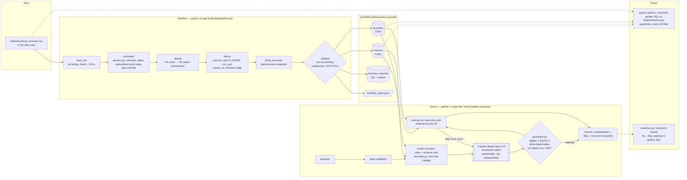

# Architecture

Matches the code as built (module names in brackets).

**Trust boundary:** the LLM never produces a number. It produces SQL, which is checked and
executed against data that business rules have already been applied to. Every number the user
sees comes from DuckDB.
